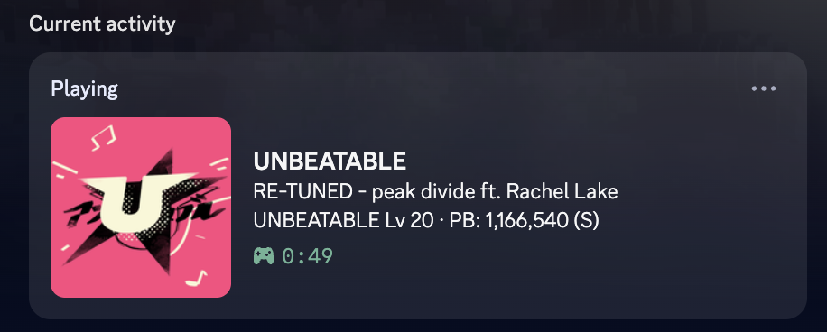
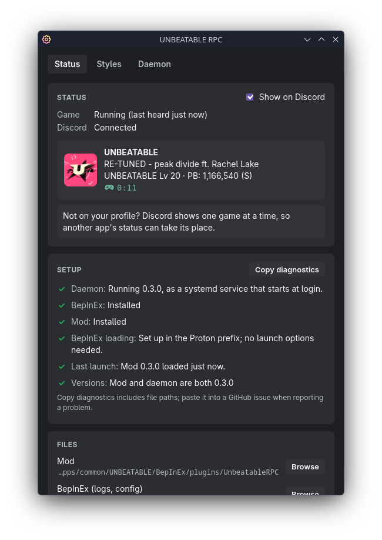
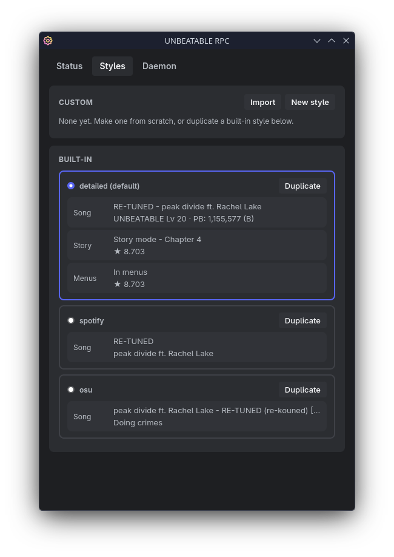

# better-unbeatable-rpc

[](https://github.com/decbr/better-unbeatable-rpc/releases/latest)
[](https://github.com/decbr/better-unbeatable-rpc/actions/workflows/release.yml)
[](docs)

<h2 align="center">
    Discord Rich Presence for <a href="https://store.steampowered.com/app/2240620/UNBEATABLE/">UNBEATABLE</a> that tells people what you're playing.
</h2>

<p align="center">
  
</p>

<p align="center">
  
  
</p>

## How it works

```
UNBEATABLE                                  Your PC                               Client
┌─────────────────────────┐   UDP 47820   ┌──────────────────┐  discord-ipc-0   ┌─────────────────────────┐
│ BepInEx + UnbeatableRPC ├─────────────▶│ unbeatable-rpc   ├─────────────────▶│ Discord, or Vesktop     │
│ (reads game state)      │  JSON, local  │ (daemon, Go)     │ Win: named pipe  │ with arRPC on           │
└─────────────────────────┘               └──────────────────┘ Linux: Unix pipe └─────────────────────────┘
```

A BepInEx plugin reads the game's state and sends it to a small daemon, which updates Discord. Under Proton the game can't reach Linux's Discord socket, so the split is what makes it work there; Windows uses the same plugin and daemon. The plugin also turns off the game's own leftover Discord integration ("UNBEATABLE [white label]").

## Install

### Windows (experimental)

Built and tested from Linux, sorry if something's off! It shouldn't be, a broken release should never make it to prod; but bugs *do* happen. If something doesn't work, [open an issue](https://github.com/decbr/better-unbeatable-rpc/issues) with the settings app's **Copy diagnostics** output.

1. Download the latest `-windows-x86_64.zip` from [releases](https://github.com/decbr/better-unbeatable-rpc/releases) and extract it.
2. Quit the game, then double-click **install.cmd**.
3. Launch UNBEATABLE.

### Linux (best)

1. Download the latest `-linux-x86_64.tar.gz` from [releases](https://github.com/decbr/better-unbeatable-rpc/releases) and extract it.
2. Quit the game, then run `./install.sh` in the extracted folder.
3. Launch UNBEATABLE.

Works with Vesktop (arRPC on) or the official Discord client. The settings app needs WebKitGTK 4.1.

The settings app is **UNBEATABLE RPC** in your Start menu or app menu. See [Install](docs/install.md) for what the installer does, its options and uninstalling.

## Documentation

- [Install](docs/install.md): what the installers do, their options, and uninstalling
- [Styles](docs/styles.md): the built-in styles, custom styles and sharing them
- [Settings](docs/settings.md): the settings file, environment variables and flags
- [Troubleshooting](docs/troubleshooting.md): when nothing shows up in Discord
- [Building](docs/building.md): building from source, for Linux and Windows

---

Unofficial fan project, not affiliated with D-CELL GAMES. UNBEATABLE is a trademark of its owners :)
