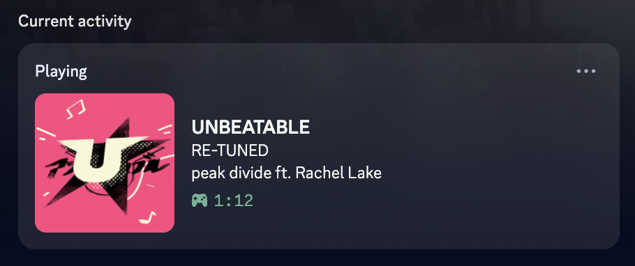
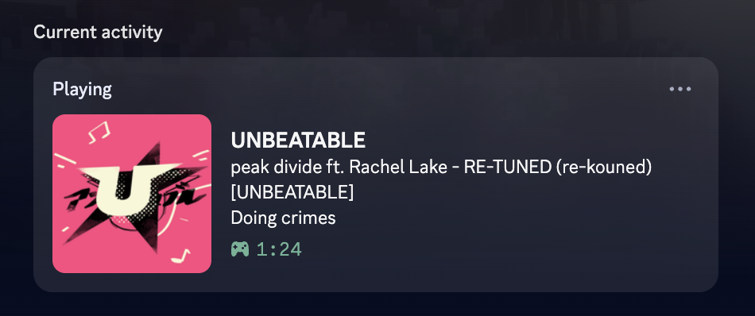
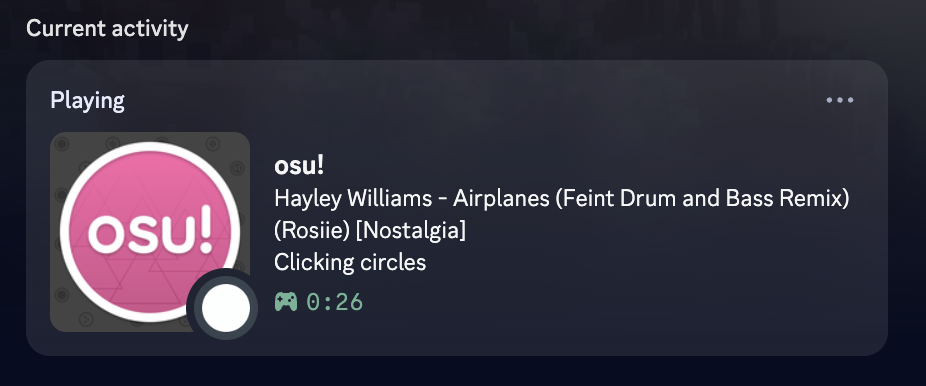

# Styles

A style decides the two lines of text Discord shows. To switch, open **UNBEATABLE RPC** and pick one on the **Styles** tab. It takes effect within a few seconds, no restart needed.

The timer shows how long the game has been open, in every state and every style. The PB is for the board you're playing on: Classic, Double Time or Half Time.

## detailed (default)

| Where you are | Top line | Second line |
|---|---|---|
| Arcade song | **RE-TUNED - peak divide ft. Rachel Lake** | UNBEATABLE Lv 20 · PB: 1,166,540 (S) |
| Paused | **RE-TUNED - peak divide ft. Rachel Lake (paused)** | same |
| Results | **Results: RE-TUNED - peak divide ft. Rachel Lake** | same, PB updated if you just beat it |
| Story mode | **Story mode - Chapter 4** | ★ 8.703 |
| Menus | **In menus** | ★ 8.703 (your star rating) |

## spotify

Title on top, artist underneath.

## osu

osu!'s own status, done for UNBEATABLE: `artist - title (charter) [difficulty]`.

## In story mode and menus

| Style | Song | Story mode | Menus |
|---|---|---|---|
| `spotify` | **RE-TUNED** / peak divide ft. Rachel Lake | **Story mode** / Chapter 4 | **In menus** / ★ 8.703 |
| `osu` | **peak divide ft. Rachel Lake - RE-TUNED (re-kouned) [UNBEATABLE]** / Doing crimes | **Story mode** / Chapter 4 | **In menus** / ★ 8.703 |

## Custom styles

On the **Styles** tab, **New style** makes your own, or **Duplicate** starts from a built-in one. Each state (song, results, a song in story mode, story mode, menus) has two lines, built from pieces you drag in: plain text, or one of

`title` `artist` `charter` `difficulty` `level` `pb` `rank` `stars` `chapter`

Click a piece to give it text before and after, like ` - ` before `artist`. A piece is left out when its information is missing, along with that text, so a song with no artist doesn't end in a stray ` - `. It can show something else instead: `pb` with *No PB yet*.

### As text

**Edit as text** shows the lines as templates, which is what's saved:

| Template | Means |
|---|---|
| `{title}[ - {artist}]` | a title piece, then an artist piece with ` - ` before it; the square brackets mark what's left out together |
| `[PB: {pb}\|No PB yet]` | what's after the `\|` when there's no PB |
| `\[` `\]` `\{` `\}` `\|` `\\` | the character itself |

Results falls back to Song, and a story-mode song to Story, when left empty. Story and Menus fall back to `detailed`.

## Sharing

**Copy** puts a style on your clipboard as text to paste anywhere, and **Save…** writes it to a `.json` file. **Import** takes either: paste the text (a chat message around it is fine) or open the file. It opens in the editor so you can check it before saving.

Without the app, see [Settings](settings.md): custom styles live in the settings file under `customStyles`, and `style` can name one.
